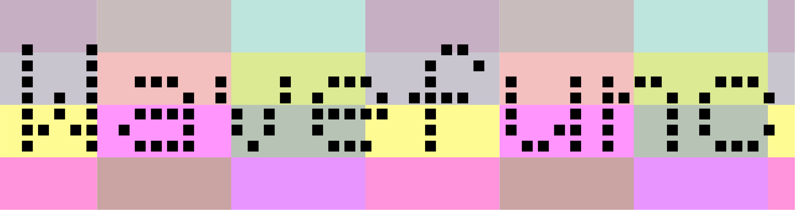
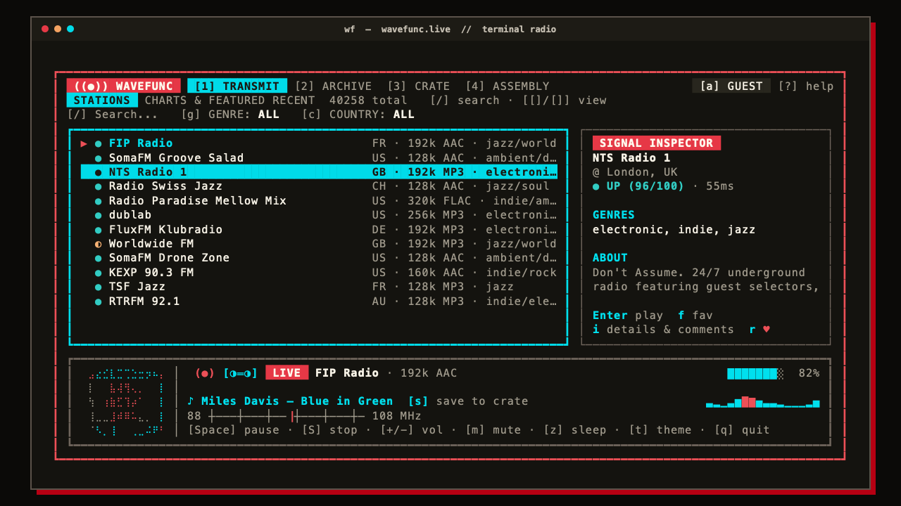

<div align="center">

<a href="https://wavefunc.live">
  
</a>

### Decentralized internet radio directory & player on Nostr

**40,000+ live stations** across **Web**, **Terminal (`wf`)**, **Desktop**, and **Android** — backed by a single-binary Khatru + LMDB + Bleve relay.

<p>
  <a href="https://wavefunc.live"></a>
  <a href="https://wavefunc.live/apps"></a>
  <a href="https://github.com/zeSchlausKwab/wavefunc/releases/latest"></a>
  <a href="https://github.com/zeSchlausKwab/wavefunc/actions/workflows/checks.yml"></a>
  <a href="LICENSE"></a>
</p>

<p>
  <a href="https://wavefunc.live"><strong>Listen Live</strong></a> &nbsp;·&nbsp;
  <a href="#terminal-ui-wf"><strong>Terminal UI (wf)</strong></a> &nbsp;·&nbsp;
  <a href="#clients--surfaces"><strong>Clients</strong></a> &nbsp;·&nbsp;
  <a href="#architecture"><strong>Architecture</strong></a> &nbsp;·&nbsp;
  <a href="#nostr-protocol"><strong>Protocol</strong></a> &nbsp;·&nbsp;
  <a href="#local-development"><strong>Local Dev</strong></a>
</p>

</div>

---

## Terminal UI (`wf`)

<div align="center">
  <a href="https://wavefunc.live/apps">
    
  </a>
  <br />
  <sub><em><code>wf</code> in Sonic Dark mode — <a href="https://wavefunc.live/apps">watch the looping terminal teaser & grab downloads at wavefunc.live/apps</a></em></sub>
</div>

<br />

`wf` is a single static Go + Bubble Tea terminal client for WaveFunc Radio. It searches and streams 40,000+ live stations directly from `wss://relay.wavefunc.live`, reads live ICY track metadata straight in Go, and syncs favorites (`kind 30078`), Song Crate tracks (`kind 31337`), reactions (`kind 7`), and NIP-22 comments (`kind 1111`) with the web, desktop, and mobile clients.

- **Zero-friction start** — listen immediately as a guest, or sign in via generated local key (OS Keychain / NIP-49 encrypted fallback), `npub` read-only mode, or a compact terminal QR code for NIP-46 remote signers (Amber, NsecBunker, etc.).
- **Constructivist TUI** — fixed-frame layout with `Sonic Dark` and `Constructivist Paper` themes (`t`), pure-Go rotating Unicode Braille 3D cube, spring-physics equalizer, and live station inspector.
- **Native audio backends** — auto-detects `mpv` (recommended, controlled over JSON IPC for instant volume, mute, and pause), `ffplay`, or `vlc` with automatic stream fallback.

### Install `wf`

**Homebrew** (macOS & Linuxbrew — installs `wf` + `mpv` so audio works out of the box):

```sh
brew install zeSchlausKwab/tap/wf
```

**macOS & Linux** (arm64 / x86_64, single static binary, SHA-256 verified):

```sh
curl -fsSL https://wavefunc.live/install.sh | sh
```

**Windows** (PowerShell, x86_64, SHA-256 verified):

```powershell
irm https://wavefunc.live/install.ps1 | iex
```

**From source** (Go 1.25+):

```sh
git clone https://github.com/zeSchlausKwab/wavefunc.git
cd wavefunc/tui && go install ./cmd/wf
```

Prebuilt binaries and `wf_checksums.txt` are also attached to every [GitHub Release](https://github.com/zeSchlausKwab/wavefunc/releases/latest).

> **Audio backend:** If installing without Homebrew, make sure `mpv` (recommended), `ffmpeg` (`ffplay`), or `vlc` is on your `PATH` (`brew install mpv` on macOS, `sudo apt install mpv` on Debian/Ubuntu, `winget install mpv.net` or `scoop install mpv` on Windows).

### Usage

```sh
wf                                  # Launch interactive TUI
wf --lucky                          # Tune immediately into a live featured station
wf play "ambient"                   # Search and play the top match right away
wf --theme light                    # Start in Constructivist Paper light mode
wf --relay ws://localhost:3334      # Connect to a local or self-hosted relay
```

<details>
<summary><strong>Keybindings reference</strong></summary>

| Key | Action |
| --- | --- |
| `1`–`4` / `Tab` | Switch tabs: `TRANSMIT` · `ARCHIVE` · `CRATE` · `ASSEMBLY` |
| `j`/`k` or `↑`/`↓` | Move cursor (`PgUp`/`PgDn` to jump) |
| `[` / `]` | Switch sub-view (Stations / Charts / Recent, Crate / Signals) |
| `/` | Full-text NIP-50 station search |
| `g` / `c` / `x` | Cycle genre · cycle country · clear active filters |
| `Enter` | Play selected station (or stream inside Inspector) |
| `Space` / `S` | Pause/Resume · Stop playback |
| `+` / `-` / `m` | Volume up / down · Mute toggle |
| `z` | Cycle sleep timer (`15m` → `30m` → `60m` → off) |
| `f` / `s` / `r` | Favorite station · Save live ICY track to Crate · React `♥` |
| `i` | Station Inspector, stream selector & NIP-22 comments |
| `a` | Account, Nostr login (NIP-46 QR / `nsec` / keygen) & settings |
| `t` / `?` / `q` | Toggle theme · Help · Quit |

</details>

---

## Clients & Surfaces

Every WaveFunc client speaks the same Nostr event schemas, so favorites, saved songs, comments, and listening history stay in sync across devices without a central account database.

| Surface | Path | Stack | Highlights |
| --- | --- | --- | --- |
| **Web App** | [`src/`](src) | React 19, TypeScript, TanStack Router, Tailwind CSS, Applesauce v7, RxJS, Bun | Live at [wavefunc.live](https://wavefunc.live) — SSR public radio directory, Signal Charts, Song Crate, Assembly feed, Cashu & NWC zaps |
| **Terminal UI (`wf`)** | [`tui/`](tui) | Go 1.25, Bubble Tea, Lip Gloss, Harmonica, `fiatjaf.com/nostr` | Single static binary, ICY metadata, Braille 3D cube, NIP-46 QR login, OS Keychain / NIP-49 storage |
| **Desktop & Android** | [`app/`](app) & [`crates/wavefunc-core/`](crates/wavefunc-core) | Flutter + shared Rust core | Android, macOS, Linux, and Windows builds with native playback and Crate media backup ([downloads](https://wavefunc.live/apps)) |
| **Nostr Relay** | [`relay/`](relay) | Go 1.25, Khatru, LMDB, Bleve v2 | Dedicated station & social relay with NIP-50 full-text search and NIP-45 `COUNT` over 40,000+ stations — zero external DBs |
| **ContextVM** | [`contextvm/`](contextvm) | TypeScript, Bun, `@contextvm/sdk` | Nostr-native RPC service for live ICY metadata extraction, MusicBrainz enrichment, and station health/now-playing observations |

---

## Architecture

```text
  ┌───────────────────┐   ┌───────────────────┐   ┌───────────────────────┐
  │   Web (src/)      │   │  Terminal (wf)    │   │ Desktop & Android     │
  │ React 19 + Bun    │   │ Go + Bubble Tea   │   │ Flutter + Rust Core   │
  └─────────┬─────────┘   └─────────┬─────────┘   └───────────┬───────────┘
            │                       │                         │
            └───────────────────────┼─────────────────────────┘
                                    │ Nostr (WebSocket)
                                    ▼
            ┌─────────────────────────────────────────────────┐
            │        WaveFunc Relay (relay/main.go)           │
            │  Khatru  ·  LMDB Store  ·  Bleve v2 (NIP-50)    │
            │          wss://relay.wavefunc.live              │
            └───────────────────────┬─────────────────────────┘
                                    │
                   ┌────────────────┴────────────────┐
                   ▼                                 ▼
     ┌───────────────────────────┐     ┌───────────────────────────┐
     │   ContextVM (contextvm/)  │     │    User NIP-65 Relays     │
     │ ICY · MusicBrainz · Obs   │     │ Profiles · Outbox · Auth  │
     └───────────────────────────┘     └───────────────────────────┘
```

### Repository Structure

```text
wavefunc/
├── src/                     # Web app (React 19 + TanStack Router + Bun SSR)
├── tui/                     # wf terminal client (Go + Bubble Tea)
│   ├── cmd/wf/              # CLI entry point
│   └── internal/            # auth, config, nostr, player, ui
├── app/                     # Flutter mobile & desktop app
├── crates/wavefunc-core/    # Shared Rust core for native clients
├── relay/                   # Khatru Nostr relay (LMDB + Bleve v2 search)
├── contextvm/               # Nostr RPC sidecar (metadata & enrichment)
├── public/                  # Static assets, install.sh, install.ps1, teaser media
├── scripts/                 # Dev orchestration, migration, teaser recording, deploy
├── docs/                    # Architecture, Applesauce v7, deployment & native guides
├── SPEC.md                  # Radio station & WaveFunc Nostr event specification
├── SONG_SPEC.md             # Song / Crate event specification (kind 31337)
└── DESIGN.md                # Visual design system
```

---

## Nostr Protocol

WaveFunc stores its directory and user state as standard and addressable Nostr events. See [SPEC.md](SPEC.md), [SONG_SPEC.md](SONG_SPEC.md), and [docs/APPLESAUCE_V7.md](docs/APPLESAUCE_V7.md) for the full schemas and relay routing policy.

| Kind | Description | Usage |
| --- | --- | --- |
| `31237` | Radio Station | Addressable station definition, streams, genre/country/language tags |
| `31238` | Station Health | Observer reachability and stream status snapshots |
| `31239` | Now Playing | Observer-reported live track snapshots |
| `31240` | Signal Charts | Computed station ranking snapshots |
| `31337` | Song / Track | Saved tracks in a listener's Song Crate |
| `30078` | App-Specific Data (NIP-78) | Cross-device favorites lists, song lists, and curated featured collections |
| `1111` | Comments (NIP-22) | Threaded station comments |
| `7` | Reactions (NIP-25) | Station and post reactions |
| `1` | Short Text Notes | `#wavefunc` Assembly community feed |
| `1985` | Labels (NIP-32) | Community station reports and curation labels |
| `30315` | User Status (NIP-38) | Opt-in live listening status |
| `9321` / `9735` | Nutzaps / Zaps | Cashu and Lightning support zaps |
| `0` / `10002` / `5` | Core Social | User profiles, NIP-65 relay lists, and NIP-09 deletions |

**Supported NIPs:** NIP-01, NIP-09, NIP-11, NIP-12, NIP-15, NIP-16, NIP-20, NIP-22, NIP-25, NIP-32, NIP-33, NIP-38, NIP-40, NIP-45, NIP-46, NIP-49, NIP-50, NIP-65, NIP-78.

---

## Local Development

### Prerequisites

- **[Bun](https://bun.sh)** `1.3.11+` (web app, ContextVM, tests)
- **[Go](https://go.dev)** `1.25+` (relay and `wf` terminal client)
- Optional: **Rust** + **Flutter** for native desktop/Android builds (`app/`), and `mpv` / `ffplay` / `vlc` for `wf` audio playback

### Quick Start

```sh
# 1. Install JS/TS dependencies
bun install --frozen-lockfile

# 2. Start local relay + seed 100 real stations + ContextVM + Web UI (http://localhost:3000)
bun dev
```

Run the terminal client against the live production relay or your local dev relay:

```sh
bun run tui        # Connects to wss://relay.wavefunc.live
bun run tui:dev    # Connects to ws://localhost:3334
```

### Scripts Reference

| Area | Command | Description |
| --- | --- | --- |
| **Web & Dev** | `bun dev` | Start relay, import 100 real stations, start ContextVM & web app (preserves existing data) |
| | `bun dev:no-seed` | Start all dev services without importing stations |
| | `bun run dev:frontend` | Start only the web frontend against already-running services |
| | `bun run build` / `bun start` | Build production bundle / run production web server |
| **Terminal UI** | `bun run tui` / `bun run tui:dev` | Run `wf` against production or local relay |
| | `bun run tui:build` | Build local `dist/wf` binary |
| | `bun run tui:test` | Run Go TUI tests with `-race` |
| | `bun run tui:record` | Re-render the WebM/MP4/PNG terminal teaser (macOS) |
| **Relay & Data** | `bun run relay` | Start standalone Go relay on `:3334` (`./relay/data/`) |
| | `bun run relay:kill` | Stop this checkout's relay without deleting data |
| | `bun run relay:reset` | Clear local LMDB store + Bleve search index and restart |
| | `bun run relay:reindex` | Rebuild Bleve index from existing LMDB events |
| | `bun run migrate` / `bun run seed` | Import 500 legacy stations / seed fake test stations |
| **Native Apps** | `bun run native:test` | Run Rust core tests + Flutter analyze & tests |
| | `bun run native:build:mac` | Build macOS release app (also `:linux`, `:win`, `:android`) |
| **Verification** | `bun run typecheck` | Run TypeScript type check across app, scripts, and tests |
| | `bun run test` | Run automated Bun test suite |

<details>
<summary><strong>Standalone relay flags & additional docs</strong></summary>

```sh
cd relay && go run . \
  --host 127.0.0.1 \
  --port 3334 \
  --db-path ./data/events \
  --search-path ./data/search
```

Additional documentation:
- [DESIGN.md](DESIGN.md) — Constructivist design system
- [docs/APPLESAUCE_V7.md](docs/APPLESAUCE_V7.md) — Nostr event store, relay routing & account architecture
- [docs/CONTEXTVM_SETUP.md](docs/CONTEXTVM_SETUP.md) — ContextVM metadata & enrichment service
- [docs/NATIVE_MEDIA_DOWNLOADS.md](docs/NATIVE_MEDIA_DOWNLOADS.md) — Native Crate media backup
- [docs/DEPLOYMENT.md](docs/DEPLOYMENT.md) — Production deployment guide

</details>

---

## Contributing & License

Contributions, bug reports, and protocol proposals are welcome! Before opening a PR, please check [SPEC.md](SPEC.md) / [SONG_SPEC.md](SONG_SPEC.md) if touching Nostr event schemas and run the relevant checks:

```sh
bun run typecheck && bun run test
bun run tui:test
```

Released under the [MIT License](LICENSE).
